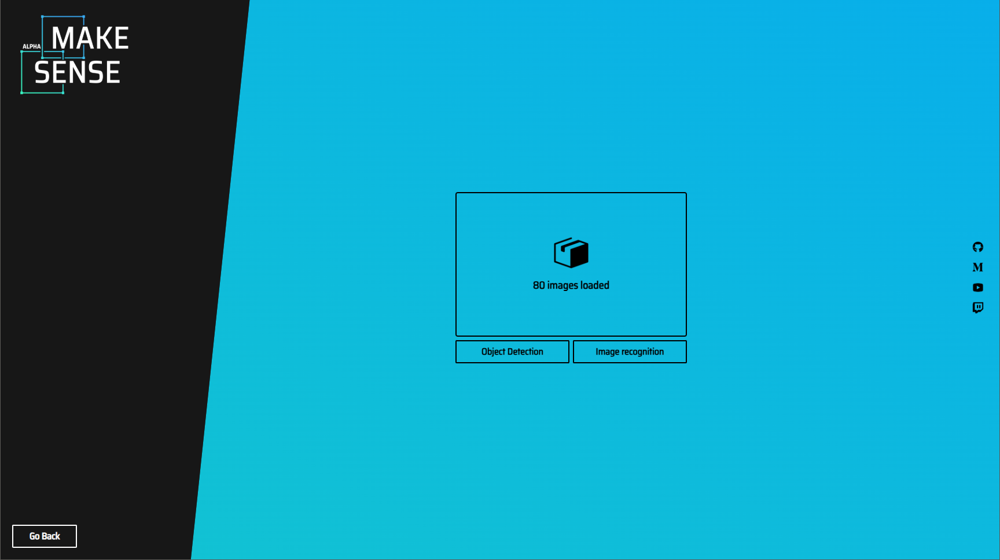
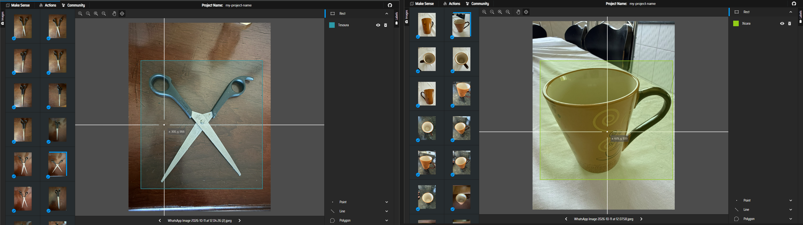
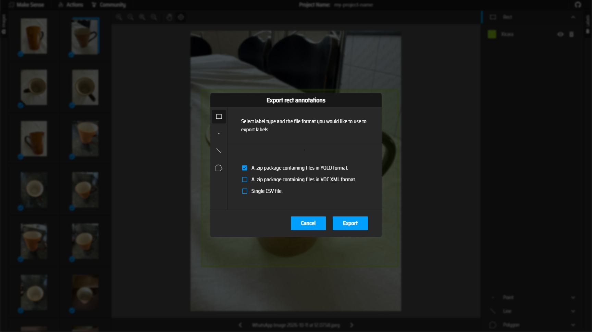
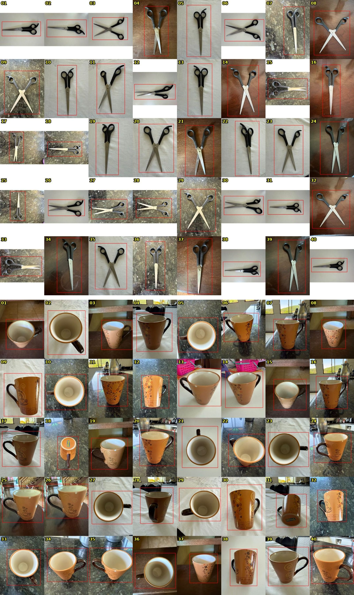

# FIAP — FarmTech Solutions | Fase 6 · Entregas 1 e 2

**Visão computacional: detecção de xícaras e tesouras** com YOLOv5s customizado, YOLOv3 pré-treinado no COCO e uma CNN treinada do zero.

## Integrantes

| Integrante | RM |
|---|---:|
| Lauren Cota | 569789 |
| Jonathas Martins de Araujo | 574051 |
| Carlos Magno Barcelos | 569944 |

## Acessar o trabalho

- 📓 **Notebook (Colab/Jupyter):** [Lauren_Cota_rm569789_Jonathas_Martins_de_Araujo_rm574051_Carlos_Magno_Barcelos_rm569944_pbl_fase6.ipynb](Lauren_Cota_rm569789_Jonathas_Martins_de_Araujo_rm574051_Carlos_Magno_Barcelos_rm569944_pbl_fase6.ipynb)
- ▶️ **Abrir direto no Colab:** [](https://colab.research.google.com/github/jonathasArauj/FIAP_IA_TURMAB_GRUPO_BH_MG_FASE6/blob/main/Lauren_Cota_rm569789_Jonathas_Martins_de_Araujo_rm574051_Carlos_Magno_Barcelos_rm569944_pbl_fase6.ipynb)
- 🎥 **Vídeo das Entregas 1 e 2 (YouTube, não listado):** [Assistir no YouTube](https://www.youtube.com/watch?v=OJptq_DrTHc)

Todo o passo a passo, os resultados e as conclusões estão no notebook; este README apenas orienta a execução.

## ⚠️ Antes de executar: o dataset precisa estar no seu Google Drive

O notebook roda no **Google Colab** e lê o dataset do **Google Drive de quem executa**. Ele não baixa as imagens sozinho; sem este passo, a execução para com a mensagem *"Dataset não encontrado no Drive"*.

O arquivo necessário é o [`dataset_fase6.zip`](data/Fase%206%20-%20Dataset/dataset_fase6.zip) (80 imagens e 80 rótulos YOLO, cerca de 17 MB). O caminho final no Drive deve ser exatamente:

`Meu Drive/Fase 6 - Dataset/dataset_fase6.zip`

### Opção A: automática (recomendada)
Abra o notebook no Colab, crie uma célula de código **antes de todas as outras**, cole o texto abaixo e execute. Ela monta o Drive e baixa o zip do GitHub para o lugar certo:

```python
from google.colab import drive
drive.mount('/content/drive')

# Cria a pasta no Drive e baixa o dataset deste repositório
!mkdir -p "/content/drive/MyDrive/Fase 6 - Dataset"
!wget -q -O "/content/drive/MyDrive/Fase 6 - Dataset/dataset_fase6.zip" "https://raw.githubusercontent.com/jonathasArauj/FIAP_IA_TURMAB_GRUPO_BH_MG_FASE6/main/data/Fase%206%20-%20Dataset/dataset_fase6.zip"
!ls -lh "/content/drive/MyDrive/Fase 6 - Dataset"
```

### Opção B: manual
1. Baixe o [`dataset_fase6.zip`](data/Fase%206%20-%20Dataset/dataset_fase6.zip) (abra o arquivo no GitHub e clique em **Download raw file**) ou baixe o repositório inteiro em **Code → Download ZIP**.
2. No [Meu Drive](https://drive.google.com/drive/my-drive), crie a pasta **`Fase 6 - Dataset`** e envie o zip para dentro dela, **sem renomear**.

### Depois
Abra o notebook no Colab, escolha **GPU T4** em *Ambiente de execução → Alterar tipo de ambiente de execução*, autorize o acesso ao Drive e use **Executar tudo**.

O notebook extrai o ZIP para o disco temporário do Colab e grava os resultados de cada nova execução em `Meu Drive/Fase 6 - Dataset/resultados/`. Os resultados da execução apresentada (12/10/2026, GPU T4) já estão no próprio notebook e na pasta [`assets/`](assets/); eles **não são necessários para rodar**.

## Evidências da rotulação (Make Sense AI)

As anotações foram feitas no [Make Sense AI](https://www.makesense.ai/) e exportadas em formato YOLO. A rotulação foi feita sobre as fotos originais do celular; depois, cada rótulo foi ligado à sua foto pela comparação exata dos arquivos e renomeado para o nome final (`xicara_NN`, `tesoura_NN`) conforme o `dataset_fase6/mapa_nomes.csv`. As 80 caixas foram conferidas visualmente.

| 1. 80 imagens importadas | 2. Caixas revisadas (uma de cada classe) | 3. Exportação YOLO |
|:---:|:---:|:---:|
|  |  |  |

<details>
<summary>Conferência das 80 caixas (gerada a partir dos rótulos finais)</summary>


</details>

## Estrutura do repositório

- Notebook principal: `Lauren_Cota_..._pbl_fase6.ipynb`, na raiz do repositório.
- `data/Fase 6 - Dataset/`: pasta a enviar ao Drive; contém o `dataset_fase6.zip` (imagens e rótulos) e, como registro, `resultados/` com a execução apresentada (opcional para rodar).
- `dataset_fase6/`: ficha do dataset (`DATASET_CARD.md`), classes, `data_info.json` e `mapa_nomes.csv`. As imagens e os rótulos ficam no `dataset_fase6.zip` de `data/Fase 6 - Dataset/`.
- `assets/`: artefatos da execução apresentada (`execucao_20261012T192935_456034Z`): `imagens/` (figuras e imagens de teste processadas), `tabelas/` (métricas em CSV), `modelos/` (pesos YOLO de 30 e 60 épocas e CNN), `makesense/` (capturas da rotulação), `logs/` (registro dos dois treinos e curvas geradas pelo YOLOv5), `resultados.json`, `selecao_validacao.json` e `ambiente_pip_freeze.txt`.
- `requirements.txt` e `assets/ambiente_experimento.txt`: dependências do experimento.

## Reprodutibilidade e limitações

O dataset tem apenas 80 imagens (um objeto por foto, um único tipo de ambiente); os resultados são exploratórios e não demonstram generalização para outros cenários. As caixas foram pré-sugeridas por ferramentas automáticas (COCO e U²-Net) e revisadas manualmente no Make Sense, o que pode favorecer modelos pré-treinados no COCO. Essa e as demais limitações estão discutidas no notebook e no [cartão do dataset](dataset_fase6/DATASET_CARD.md).
