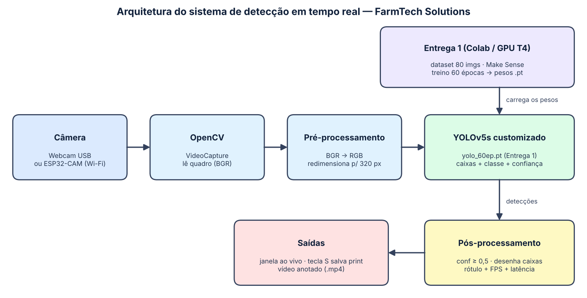

# Ir Além (opção 3.1) — Detecção em tempo real com webcam / ESP32-CAM

Aplicação em Python que lê vídeo de uma **webcam do PC** ou de uma **ESP32-CAM** (Wi-Fi) e aplica o modelo **YOLOv5s da Entrega 1** (60 épocas) para reconhecer **xícaras** e **tesouras** em tempo real.



## Onde está cada coisa

| Item | Arquivo |
|---|---|
| 📓 Notebook com justificativa, arquitetura, código, resultados e análise crítica | [src/Lauren_Cota_rm569789_Jonathas_Martins_de_Araujo_rm574051_Carlos_Magno_Barcelos_rm569944_pbl_fase6_ir_alem.ipynb](src/Lauren_Cota_rm569789_Jonathas_Martins_de_Araujo_rm574051_Carlos_Magno_Barcelos_rm569944_pbl_fase6_ir_alem.ipynb) |
| 🐍 Código-fonte comentado | [src/detector_webcam.py](src/detector_webcam.py) |
| 🖼️ Figura de arquitetura | [assets/01_arquitetura.png](assets/01_arquitetura.png) |
| 🖼️ Detecções do modelo nas imagens de teste | [assets/02_deteccoes_modelo_60ep.png](assets/02_deteccoes_modelo_60ep.png) |
| 🎥 Vídeo do Ir Além | [Assistir no YouTube](https://youtu.be/O0JVEmJvkYo) |

## Como executar

```bash
cd "ANO1/FASE 6/ir_alem/src"
pip install -r ../requirements_ir_alem.txt

python detector_webcam.py                                   # webcam do PC
python detector_webcam.py --fonte http://192.168.0.50:81/stream   # ESP32-CAM na mesma rede Wi-Fi
python detector_webcam.py --fonte video.mp4 --sem-janela --saida resultado.mp4   # vídeo de teste
```

Teclas: **Q/ESC** sai · **S** salva o quadro anotado em `assets/prints_webcam/`. Na primeira execução é necessário internet (o `torch.hub` baixa o código do YOLOv5 no mesmo commit do treino).

## Por que esta solução
- Reaproveita o modelo escolhido pela validação na Entrega 1.
- A webcam dispensa compra de hardware; a ESP32-CAM entra só trocando `--fonte`, pois o OpenCV lê o stream MJPEG como uma webcam.
- A câmera só captura; a inferência roda no PC (a ESP32 não comporta uma YOLO).

## Limitações
Detalhadas no notebook (seção 6): velocidade em CPU, dataset pequeno, apenas duas classes e ESP32-CAM ainda não testada com o hardware real.
